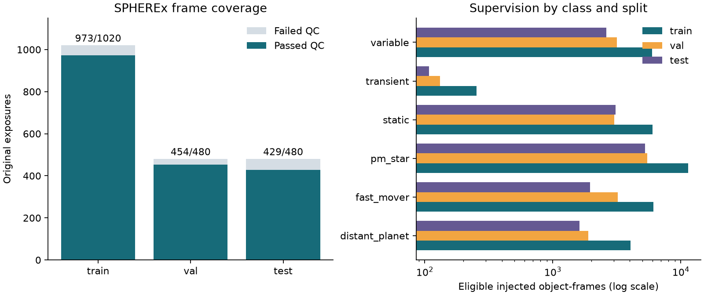

# SPHEREx change detection with Planet X v1.3.0

The 50/50 blend of the new boosted tree and the previous cutout CNN reached **77.22% binary F1** on the eight recurring test fields, up from **70.65%** for the earlier CNN. The validation-selected threshold was 0.509855. Of the 4,542 alerts, 3,665 matched a labelled change and 877 were labelled background. There were 4,950 labelled change candidates in total.

| Model at its validation-selected threshold | Test precision | Test recall | Test F1 | Average precision |
| --- | ---: | ---: | ---: | ---: |
| Prior cutout CNN, archived run | 79.86% | 63.35% | 70.65% | 75.92% |
| New boosted tree with spatial and temporal neighbours | 77.64% | 65.88% | 71.28% | 77.08% |
| Selected 50/50 blend | 80.69% | 74.04% | 77.22% | 82.29% |

Binary accuracy was **98.17%** and four-class accuracy was **97.98%**. At least one alert had the correct class for **118/127 moving**, **50/60 variable** and **7/76 transient** eligible objects. Of 93 proposed transient peaks, 68 were classified as motion. Across the eight fields, candidate F1 ranged from 54.00% in M31 to 84.01%. Validation F1 rose from 73.89% for the first tree to 76.69% with neighbour features and 80.89% for the blend.

[Field results](ensemble_fields.csv) · [Confusion matrix](ensemble_confusion.csv) · [Object recovery](ensemble_objects.csv) · [Frame recovery](ensemble_frames.csv) · [Original CNN benchmark](../kaggle_cnn/results.json)

On the original images the blend matched Epsilon Indi B in 11 of 42 eligible frames, WISE 0855 in 0 of 29 and RW Aurigae in 0 of 2. The other two targets had no eligible frames. These checks use the expected class and a two-pixel positional match. [Named target measurements](ensemble_targets.csv)

## Dataset and EDA

The supplied v1.3 archive (SHA-256 `e7dde2f15d429e3db28e63cac3005f2d9c4c193b275db56538864e2808bdbf79`) adds EDA and training metadata to the existing sky fields. This run uses the 198 fixed SPHEREx injections on 33 fields. The other missions appear in the release EDA. The leaderboard below covers SPHEREx only.

| Split | Sky groups | Injection realizations | QC-passed real exposures | Proposed peaks | Labelled change peaks |
| --- | ---: | ---: | ---: | ---: | ---: |
| Train | 17 | 102 | 973 / 1,020 | 405,425 | 13,587 |
| Validation | 8 | 48 | 454 / 480 | 153,256 | 7,095 |
| Test | 8 | 48 | 429 / 480 | 117,825 | 4,950 |

The original test fields contain 93 proposed transient peaks and 3,050 motion peaks. Only 108 transient object-frames meet the release eligibility criteria across those 48 injections. This scarcity motivated tracking correct-class transient recovery separately. A background-only prediction achieves 95.80% binary accuracy with zero change recall. Real catalogue coverage is incomplete, so unmatched peaks in the synthetic benchmark can also include genuine sky variability.

[Full release EDA](dataset_overlay/eda/FINDINGS.md) · [Missing values by column](dataset_overlay/eda/column_missingness.csv) · [Class counts and eligibility](dataset_overlay/eda/synthetic_distribution.csv) · [Interactive notebook](experiment.ipynb)

## Experiments

Both boosted tree models use the project's blind difference-image proposals. The first uses aperture history and residual shape. The second also counts nearby peaks, measures the distance to nearby peaks and checks whether a peak reappears with the same sign at a different epoch. These offline features use other exposures from the same realization. Inputs exclude catalogue identities, injected positions and labels. All training candidates from folds 2–4 enter each fit. We select the feature set by peak-level binary F1 on fold 1.

We then compare the two endpoints and three intermediate probability blends of the selected tree and the existing frozen Kaggle CNN. Each weight gets its own F1-maximizing validation threshold. Fold 0 measures the selected blend and threshold. Its fields appeared in earlier experiments. This paired benchmark measures recovery of simulated changes on real image backgrounds. It cannot establish accuracy on independent sky fields.

## Reproduction

Download all 39 parts of the [v1.3 dataset release](https://github.com/muathnoor123-star/spherex-change-detector/releases/tag/dataset-v1.3.0) into one folder. Join them to recover the original ZIP, then extract it. If you already have the ZIP, start with extraction. The join script checks the full SHA-256.

~~~sh
python experiments/v13/join_archive.py downloads
python -m zipfile -e downloads/planetx-dataset-v1.3.0.zip data
~~~

Users with the old v1.2 ZIP can also run `python experiments/v13/restore.py OLD.zip NEW_DIRECTORY`. We verified all 535 manifest files using that route. The 480 shared files come from the prior archive and the overlay contains the 56 new or changed files including the manifest.

Run from the repository root using Python 3.11, the pinned project dependencies and CPU PyTorch 2.15.0. The cache is written by the first experiment. Use a fresh path when changing the extraction or input data. The second experiment reuses the published CNN weights in `experiments/kaggle_cnn/model.pt`.

~~~sh
python -m pip install -r requirements.txt
python -m pip install torch==2.15.0 --index-url https://download.pytorch.org/whl/cpu
python v13_experiment.py data/planetx-dataset-v1.3.0 data/v13-candidates.parquet
python v13_ensemble.py data/planetx-dataset-v1.3.0 data/v13-candidates.parquet
~~~

The repository includes both trained checkpoints and the chosen threshold and weight in [ensemble.json](ensemble.json). [Candidate alerts from original observations](ensemble_alerts.csv.gz) contain zero-based pixel coordinates per frame. One source can trigger more than one alert.
